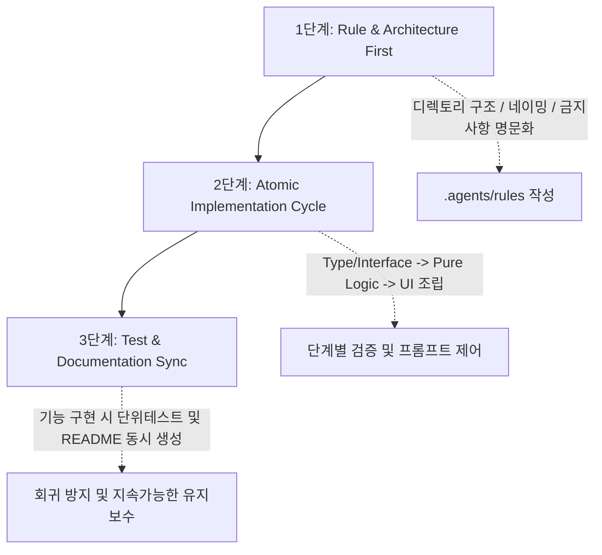

# AI Agent 기반 소프트웨어 개발 사례 연구 및 생산성 분석 보고서
(Case Study: AI-Agent-Driven Development & Productivity Analysis)

본 문서는 **fdfiletrace (TraceFile)** 프로젝트를 진행하며 약 1개월간 적용한 **AI Agent 중심의 개발 방식(Human as Architect & Reviewer)**에 대한 정량적/정성적 성과를 분석하고, 향후 프로젝트 및 조직 내 AI 도입에 참고할 수 있도록 정리한 보고서입니다.

---

## 1. 개요 (Executive Summary)

* **프로젝트명**: fdfiletrace (파일 추적 및 연계 분석 시스템)
* **개발 기간**: 2026-07-28 ~ 2026-09-05 (약 40일)
* **개발 형태**: 1인 개발 (본업과 병행하며 틈틈이 개발 + 주말/휴일 집중 개발)
* **개발 방식**: 
  - **인간 개발자**: 방향성 기획, 아키텍처/폴더 구조 설계, 요구사항 정의, 코드 리뷰 및 검증
  - **AI Agent**: 뼈대 코드 작성, 대규모 리팩토링, 알고리즘 디버깅, 라이브러리 마이그레이션, 문서화
* **핵심 성과 지표**:
  - **실제 투입 공수**: 약 **7.5 Man-Day** (총 55~60시간)
  - **전통적 손개발 대비 추정 공수**: **45 ~ 59 Man-Day** (약 2.5 ~ 3개월 분량)
  - **생산성 배율**: **약 6배 ~ 7배 향상**

---

## 2. 정량적 소모 시간 및 생산성 분석

### 2.1 Git 이력 기반 실제 소모 시간 산정

Git 커밋 로그(총 82개 커밋)의 타임스탬프와 작업 강도를 분석한 결과, 작업 패턴은 크게 두 가지로 분류됩니다.

```
[전체 개발 기간: 40일 중 실제 커밋 일수 15일]

1. 집중 몰입 개발 (Full-Day, 6~7시간/일): 총 5일
   - 07-31, 08-01, 08-27, 09-01, 09-05
   - 대규모 기능 추가, 프레임워크 개편, 아키텍처 재구조화
   - 소모 시간: 5일 × 6.5시간 = 약 32.5시간

2. 업무 병행 틈틈이 개발 (Part-Time, 1.5~2.5시간/일): 총 10일
   - 07-28, 07-30, 08-03, 08-06, 08-07, 08-18, 08-21, 08-28, 09-02, 09-04
   - 버그 픽스, 스타일 미세 조정, 단일 기능 패치
   - 소모 시간: 10일 × 2.2시간 = 약 22.5시간

=> 순수 투입 시간 총합: 약 55 ~ 60시간 (약 7.5 Man-Day)
```

---

### 2.2 영역별 공수 비교 (전통적 손개발 vs AI 협업)

| 작업 영역 | 주요 산출물 및 작업 범위 | 일반 손개발 예상 공수 (Man-Day) | 실제 투입 공수 (AI Agent 협업) |
| :--- | :--- | :--- | :--- |
| **분석기 엔진 (Node.js)** | • Java AST 파서 및 정규식 기반 호출 그래프 추출기<br>• Android 화면 ID 파서, WebView 연계 분석기<br>• DBM, CTR, MCI 전문 연계 집계기 (reportAggregator)<br>• Jenkins 파이프라인 연동 스크립트 | **12 ~ 15 MD** | **약 2.0 MD** |
| **프론트엔드 도메인 화면** | • Vue 3 + Vite 기반 SPA 아키텍처<br>• 3대 메인 뷰: API 호출 트리 뷰, MCI 마스터-디테일, Table 사전<br>• 다차원 검색/필터링/정렬 인터랙션 | **15 ~ 18 MD** | **약 2.5 MD** |
| **디자인 시스템 & 공통 컴포넌트** | • SCSS 변수 토큰화 및 레이어링 시스템, Modern CSS Reset<br>• PageLayout, BaseIcon (트리쉐이킹 지원 18종)<br>• TooltipPopover, LoadingBox, ErrorBox, EmptyBox | **6 ~ 8 MD** | **약 1.0 MD** |
| **데이터 & 성능 & 내보내기** | • 대용량 Store 가공 및 인덱싱, 역방향 호출 탐색<br>• `write-excel-file` 기반 대용량 엑셀 다운로드<br>• 디바운스 및 렌더링 최적화 | **4 ~ 6 MD** | **약 0.8 MD** |
| **리팩토링 & 유지보수** | • Tailwind CSS → SCSS 전면 전환<br>• DDD 계층형 폴더 구조 개편 (Assets, Base, Common, Domain)<br>• 무거운 라이브러리(`exceljs`) 경량화 교체 | **5 ~ 7 MD** | **약 0.8 MD** |
| **문서화 & 배포 체계** | • 아키텍처/기능 명세서, 컴포넌트별 README<br>• 시맨틱 버저닝, CHANGELOG 관리 체계, Agent 규칙(`.agents/rules`) | **3 ~ 5 MD** | **약 0.4 MD** |
| **합계 (Total)** | **완성도 높은 단독 웹 뷰어 & 분석기 도구** | **45 ~ 59 MD**<br>(약 2.5 ~ 3개월) | **약 7.5 MD**<br>(약 1.5주 / 55~60시간) |

---

## 3. 대표 사례 분석 (One-Day Case Study: 2026-09-05)

AI Agent 협업의 폭발적인 생산성은 **2026년 9월 5일 하루(약 6~7시간 실작업)** 동안 처리된 작업 목록에서 극명하게 나타납니다.

```
[2026-09-05 당일 완료된 작업 목록]
1. feat: 테이블 상세 툴팁(TooltipPopover) 연동 및 마스터 리스트 적용
2. refactor: PageLayout 공통 껍데기 도입 및 3대 메인 페이지(Api, Mci, Table) Header/Layout 전면 리팩토링
3. feat/refactor: BaseIcon 공통 컴포넌트 구현 및 전 도메인 21개 파일의 인라인 SVG 일괄 치환
4. chore: exceljs를 제거하고 write-excel-file로 내보내기 로직 전면 재작성 (번들 사이즈 최적화)
5. fix: useMetadataStore의 DBM-MCI 역방향 호출 그래프 탐색 알고리즘 누락 버그 수정
6. refactor: base/util 디렉토리 재구조화 및 Node 분석기 러너 스크립트 경로 일괄 수정
7. docs: 마크다운 문서 및 컴포넌트별 README 표준화, CHANGELOG 개편 및 v0.5.0 배포
```

> **손개발과의 차이점:**  
> 일반적인 손개발 환경에서 개발자가 혼자 작업할 경우, **21개 파일의 인라인 SVG를 찾아 BaseIcon으로 치환**하거나 **엑셀 라이브러리의 API 명세를 학습하고 재구현**하는 단순 반복 작업만으로도 1~2일이 소진됩니다. AI Agent가 이러한 단순 작업과 보일러플레이트를 수 분 내에 처리해 주었기 때문에 하루 만에 4~5 Man-Day 분량의 과업을 마칠 수 있었습니다.

---

## 4. 개발 패러다임의 변화: "손개발" vs "AI Agent 주도 개발"

```
[전통적 개발 모델]
개발자 = 설계자 + 코더 + 타이피스트 + 디버거
(뇌 리소스의 70%가 문법, 오타, 보일러플레이트, API 문서 검색에 소모됨)

[AI Agent 협업 모델]
개발자 = 소프트웨어 디렉터 & 아키텍트 (What & Why 결정, 품질 감리)
AI Agent = 주니어 개발자 풀 (How 구현, 반복 치환, 초안 작성, 린트 교정)
(뇌 리소스의 80%가 비즈니스 맥락, 사용자 경험, 디렉토리 구조 설계에 집중됨)
```

### 4.1 주요 장점
1. **인지 부하(Cognitive Load)의 극적인 전환**:
   - "이 코드를 어떻게 짜야 문법 에러가 안 날까?"에서 "이 기능을 어디에 배치해야 구조가 깔끔할까?"로 고민의 차원이 상향됨.
2. **기술 스택 학습 곡선의 제거**:
   - 새로운 라이브러리(`write-excel-file`), 복잡한 정규식, SCSS 모듈 시스템 등을 도입할 때 공식 문서를 장시간 탐색하지 않고도 즉시 검증 가능한 코드 초안을 확보.
3. **리팩토링에 대한 심리적 장벽 소멸**:
   - 손개발에서는 번거로워서 미루기 쉬운 대규모 디렉토리 개편(예: DDD 구조화, 아이콘 분리 등)을 부담 없이 즉각 실행 가능.

### 4.2 직면했던 도전 과제 및 트레이드오프
1. **코드의 '블랙박스화' 위험**:
   - AI가 생성한 코드를 충분한 리뷰 없이 머지하면, 내부 로직에 대한 멘탈 맵이 약화되어 추후 디버깅이 어려워질 수 있음.
2. **오버엔지니어링(Over-engineering) 성향**:
   - AI는 질문을 받으면 종종 불필요하게 복잡한 유틸리티나 중복된 래퍼를 생성하려는 경향이 있어, 개발자가 단호하게 쳐내는(Cut) 역할이 필수적임.
3. **프롬프트 드리프트(Prompt Drift)**:
   - 규칙이 없으면 매 턴마다 코딩 스타일이나 명명 규칙이 미세하게 흔들림.

---

## 5. 성공 요인 및 배운 점 (Lessons Learned)

이번 프로젝트가 성공적인 품질과 구조를 유지할 수 있었던 핵심 원동력은 다음과 같습니다:

1. **규칙의 문서화 (`.agents/rules/code-guide.md`)**:
   - 개발 중반 이후 폴더 구조(Assets, Base, Common, Domain), 문서화 정책, 버전 관리 정책을 명문화하여 AI에게 주입함으로써 일관성을 확보함.
2. **적극적인 가지치기(Pruning)**:
   - AI가 제안한 불필요한 의존성이나 과도한 추상화를 개발자가 판단하여 간소화함 (예: 가벼운 엑셀 라이브러리 선택, 얇은 레이아웃 껍데기 유지).
3. **향후 개선점 (Next Step)**:
   - **규칙의 조기 수립**: 프로젝트 1일 차부터 룰셋을 정의했다면 중반의 대규모 구조 변경 비용을 더 절감할 수 있었음.
   - **자동화 테스트 도입**: AI가 생성한 로직에 대해 단위 테스트(Unit Test)를 함께 작성하도록 강제했다면 리팩토링 시 화면 수동 검증 시간을 더욱 단축할 수 있었음.

---

## 6. 향후 프로젝트를 위한 AI 협업 권장 가이드라인 (Best Practices)

다음 프로젝트를 비슷한 방향으로 진행할 때 권장하는 **3단계 협업 프레임워크**입니다:



1. **Day 1 - Rule-First 접근**:
   - 코드를 짜기 전 `.agents/rules/`에 폴더 아키텍처, 상태 관리 방식, 금지 규칙을 먼저 작성.
2. **원자적(Atomic) 작업 분할**:
   - "화면 전체를 만들어줘" 대신 `타입 정의` → `데이터 가공 로직` → `UI 렌더링` 순으로 쪼개어 지시.
3. **테스트 및 문서 동시 요청**:
   - "이 함수 만들어줘" 대신 *"이 함수 만들고, 엣지 케이스를 검증하는 단위 테스트와 컴포넌트 README도 함께 작성해줘"* 패턴 적용.

---

## 7. 결론

본 프로젝트의 경험은 **"AI를 단순한 코드 자동완성 도구가 아닌, 아키텍트의 지휘를 받는 가상 개발팀(Agentic Team)으로 운용할 때 1인 개발자도 엔지니어링 팀 수준의 높은 속도와 구조적 완성도를 달성할 수 있다"**는 사실을 입증합니다. 

이러한 접근법은 사내 신규 과제, 프로토타이핑, 레거시 시스템 분석 도구 개발 등 다양한 영역에서 **개발 기간을 70~80% 단축**시키는 강력한 개발 표준 모델로 확산 적용될 수 있습니다.
